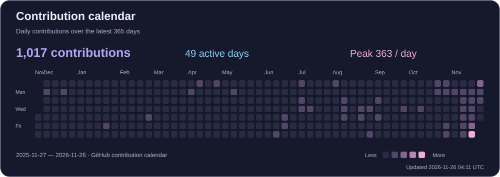
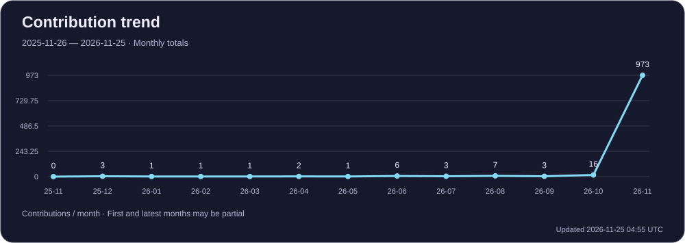
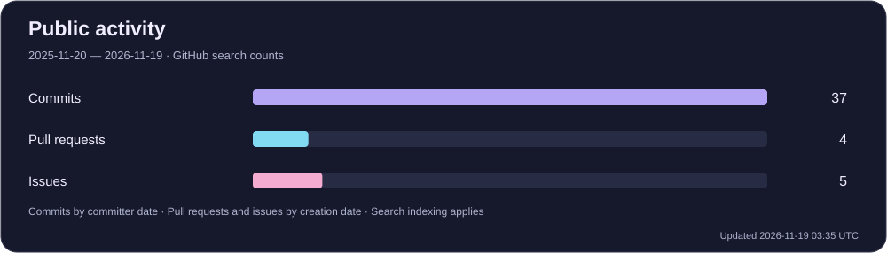
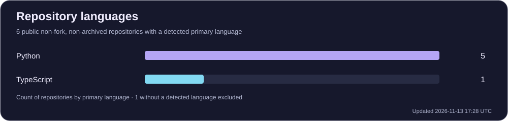
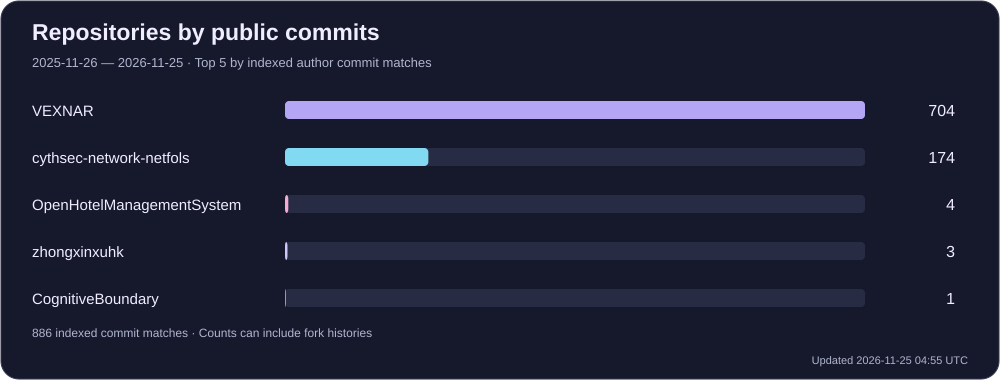

  

### 你好，我是 XUZHONGXIN 🌸

**Senior System Architect · 系统架构 / 网络安全 / AI 工具探索**

把好奇心写进代码，把想法变成可以运行的世界。

  
  
  
  

✦ Architecture &nbsp; / &nbsp; Security &nbsp; / &nbsp; Open Source &nbsp; / &nbsp; AI ✦

- 🏗️ **架构与工程** — 关注系统设计、数据库运维与工程实践。
- 🛡️ **安全与探索** — 探索网络安全、流量分析与安全工具。
- 🧩 **AI 与工作流** — 关注 AI Agent、开发工具与科研工作流。
- 🌌 **这里的日常** — 写代码、做实验、记录发现，也为有趣的开源项目点亮星星。

> **「保持好奇，持续构建。」** &nbsp; *Stay curious. Build something meaningful.*

### ✨ 贡献与代码分析

图表每日自动更新，更新时间显示在图内。贡献日历采用 GitHub 贡献规则，活动数量采用公开搜索结果。语言按仓库主要语言计数。首尾月份按实际覆盖天数汇总。<a href="assets/stats/data.json">查看数据与统计口径</a> · <a href="https://github.com/zhongxinxuhk/zhongxinxuhk/actions/workflows/profile-stats.yml">更新状态</a>

<table>
<tr>
<td width="50%" valign="top">

#### 🗄️ [DBPulse · DBCheck](https://github.com/zhongxinxuhk/DBCheck)

数据库智能巡检与运维平台，关注数据库检查、报告与运维体验。

Python · Database · Operations

基于 fiyo / Jack Ge 的 DBCheck 持续演进，保留上游署名。

</td>
<td width="50%" valign="top">

#### 🔭 [CognitiveBoundary](https://github.com/zhongxinxuhk/CognitiveBoundary)

认知边界研究的公开实验脚本，探索可复现的实验过程。

Python · Research · Experiments

公开内容为实验脚本；论文、数据与研究结果不在仓库中。

</td>
</tr>
<tr>
<td width="50%" valign="top">

#### 🤖 [BreachWeave](https://github.com/zhongxinxuhk/BreachWeave)

探索 Manager / Observer / Solver 多角色协作的安全 Agent 架构。

AI Agents · Security · Exploration

Fork 项目 · 保留并尊重上游贡献。

</td>
<td width="50%" valign="top">

#### 📚 [nature-skills](https://github.com/zhongxinxuhk/nature-skills)

探索面向科研的可复用技能，从文献阅读到写作与图表工作流。

AI Skills · Research · Workflow

Fork 项目 · 保留并尊重上游贡献。

</td>
</tr>
</table>

  <a href="https://github.com/zhongxinxuhk?tab=repositories">✧ 继续探索我的仓库 / Explore more repositories →</a>

  🌐 <a href="https://sec.hn.cn">sec.hn.cn</a>
  &nbsp; · &nbsp;
  📝 <a href="https://blog.csdn.net/qq_73252299">技术博客</a>
  &nbsp; · &nbsp;
  🔬 <a href="https://orcid.org/0009-0007-7205-9086">ORCID</a>

欢迎交流系统架构、数据库运维、网络安全与 AI 工具实践。

